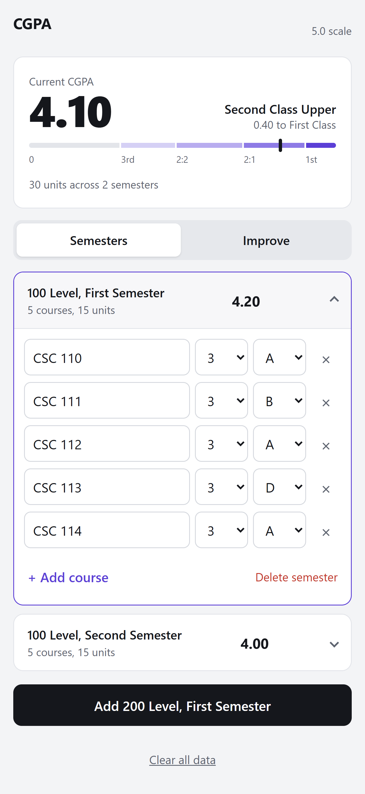
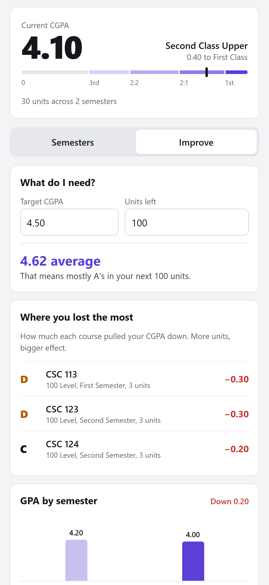

# CGPA Calculator

A mobile-first CGPA calculator for Nigerian university students on the **5.0 grading scale**. Add your semesters and courses, see your CGPA and degree class update as you type, and find out exactly what you need to reach your target.

**Live demo:** https://nursetiti.github.io/cgpa-calculator/

 

## Features

- **Semesters and courses.** Add, edit and remove semesters and courses. New semesters are named automatically (100 Level First Semester, 100 Level Second Semester, 200 Level First Semester, and so on).
- **One semester open at a time.** Other semesters collapse to a single row showing their GPA, which saves space on small screens.
- **Live CGPA and degree class.** Your CGPA, degree class and distance to the next class update instantly, with a scale bar that shows where you stand.
- **"What do I need?" planner.** Enter a target CGPA and the units you have left to see the average you need, or whether the target is still reachable.
- **Where you lost the most.** Shows the three courses that pulled your CGPA down the most, and by how much.
- **GPA by semester.** A simple bar chart with your trend from the last semester.
- **Saved on your device.** Your data is stored in `localStorage`, so it is still there when you come back. Nothing is sent to a server.
- **Accessible and mobile-friendly.** Large tap targets, native pickers on phones, keyboard focus styles and screen-reader labels.

## How the CGPA is calculated

| Grade | A | B | C | D | E | F |
|---|---|---|---|---|---|---|
| Points | 5 | 4 | 3 | 2 | 1 | 0 |

- **Quality points** for a course = units × grade points
- **GPA** = total quality points ÷ total units for one semester
- **CGPA** = total quality points ÷ total units across **all** semesters

CGPA is not the average of your semester GPAs. A semester with more units counts more.

Degree classes follow the common NUC bands:

| Class | CGPA |
|---|---|
| First Class | 4.50 – 5.00 |
| Second Class Upper | 3.50 – 4.49 |
| Second Class Lower | 2.40 – 3.49 |
| Third Class | 1.50 – 2.39 |
| Pass | 1.00 – 1.49 |

Some universities use slightly different boundaries or do not use the E grade. Check your school's handbook.

## Built with

- [React](https://react.dev/) (with Vite)
- Plain CSS with custom properties (no UI library)
- `localStorage` for saving data
- GitHub Pages for hosting

## React concepts used

- Components, props and composition
- `useState`, including lazy initial state
- `useEffect` for saving to `localStorage`
- Controlled inputs and selects
- Lifting state up, with a single source of truth in `App`
- Immutable updates with `map`, `filter` and the spread operator
- Derived data: GPA, CGPA and insights are calculated from state, never stored
- Conditional rendering and list rendering with stable keys
- Pure utility functions kept separate from components (`src/utils/gpa.js`)

## Project structure

```
src/
  components/
    Summary.jsx        CGPA, degree class and scale bar
    Tabs.jsx           Semesters / Improve switch
    SemesterCard.jsx   One semester, collapsible
    CourseRow.jsx      Course code, units, grade
    Improve.jsx        Container for the insight cards
    TargetPlanner.jsx  "What do I need?" planner
    CostlyCourses.jsx  Courses that cost the most
    GpaTrend.jsx       GPA by semester chart
    ClearData.jsx      Clear all data, with confirmation
  utils/
    gpa.js             Grade points and all calculations
  App.jsx              State and update functions
  index.css            Styles and design tokens
```

## Getting started

```bash
git clone https://github.com/nursetiti/cgpa-calculator.git
cd cgpa-calculator
npm install
npm run dev
```

To deploy to GitHub Pages:

```bash
npm run deploy
```

## Roadmap

- [ ] Desktop two-column layout
- [ ] Setting for schools that do not use the E grade
- [ ] Export or share your results
- [ ] Integrate with FocusFlow, my study planner app

## Author

**Alade Nosirat**, front-end developer and computer science student in Lagos, Nigeria.

- GitHub: [@nursetiti](https://github.com/nursetiti)
- Email: nosiratalade1@gmail.com